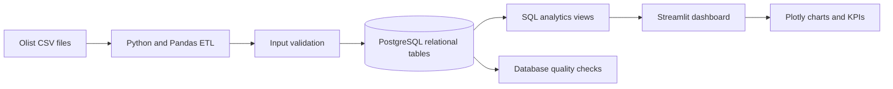

# Brazilian E-Commerce Analytics

**An end-to-end data engineering and analytics portfolio project** using public data from Brazil's Olist marketplace.

I built a reproducible pipeline that takes nine raw CSV files, validates and loads them into a relational PostgreSQL database, and turns them into SQL analytics views and an interactive dashboard. The project explores marketplace sales, delivery performance, and customer experience across nearly 100,000 orders.

## What the project delivers

- A **Python and Pandas ETL pipeline** that checks the input files, parses dates and numeric fields, and loads tables in foreign-key order.
- A **relational PostgreSQL model** with primary keys, foreign keys, and indexes for the Olist data.
- **SQL analytics views** that combine order, item, customer, product, seller, payment, delivery, and review information.
- **Data-quality checks and automated tests** to catch missing tables, broken relationships, and invalid values.
- A **Streamlit dashboard** with Plotly charts and a month-range filter for exploring sales, product categories, customer locations, delivery outcomes, and review scores.

## Questions explored

- How do order volume and merchandise sales change over time?
- Which product categories and customer states contribute most to merchandise value?
- How long do orders take to arrive, and how often do they arrive after the estimated date?
- How does delivery performance relate to customer review scores?

## Project at a glance

The local run represented in this project loaded **99,441 orders** from nine source CSVs, including **112,650 order items**, **103,886 payments**, and **99,224 reviews**. The analysis covers 24 monthly periods and 98,199 eligible orders. Nine database quality checks and five automated tests passed in that run.

These counts describe the dataset version used for the local run; they are not live marketplace figures. The original [Brazilian E-Commerce Public Dataset by Olist](https://www.kaggle.com/datasets/olistbr/brazilian-ecommerce) is distributed separately and is not stored in this repository.

## How it works



The ETL checks the expected inputs before changing the database. It refreshes the project tables in a transaction, so a failed load rolls back instead of leaving a partial refresh. Inserts are chunked to keep the workflow practical on a lightweight local machine. Source CSV files are read-only inputs.

## Data model and analytical layer

The PostgreSQL `public` schema contains customers, sellers, products, category translations, orders, order items, payments, reviews, and geolocation. Foreign keys preserve relationships between orders and customers, and between orders and their items, payments, and reviews.

The source reuses `review_id` for multiple orders, so the review table uses the composite key `(review_id, order_id)`. Geolocation contains multiple coordinates for some postal prefixes; the model preserves those records rather than arbitrarily selecting one.

The SQL layer creates two views:

- `analytics.order_line_facts`: an order-item-level view with customer, product, category, seller, payment, delivery, and review context.
- `analytics.monthly_sales`: a monthly summary of orders, buyers, merchandise value, freight, and average order value.

## Dashboard measures

All dashboard panels follow the selected order-month range.

- **GMV** is item price before freight; canceled and unavailable orders are excluded.
- **Average order value** includes item price and freight and is weighted across eligible orders in the selected range.
- **Unique buyers** counts distinct customers across the full range.
- **Late delivery** means delivery after the estimated date, among delivered orders with an estimate.
- **Review score** is averaged per order before comparing it with delivery outcomes.

## Tools and skills demonstrated

Python · Pandas · PostgreSQL · SQL · SQLAlchemy · Streamlit · Plotly · Pytest · Git

This project demonstrates data ingestion, schema design, transactional loading, SQL modeling, data validation, analytical dashboarding, and reproducible project setup.

## Run locally

The following steps reproduce the project on macOS with Anaconda and PostgreSQL.

1. Install and start PostgreSQL, then create a database named `olist`.
2. Create and activate the Conda environment:

   ```bash
   conda env create -f environment.yml
   conda activate olist-analytics
   ```

3. Copy `.env.example` to `.env`, then set the location of the nine Olist CSV files and the database connection URL. With the default Postgres.app setup, the database user is usually your macOS account name:

   ```ini
   DATA_DIR=/path/to/olist-csv-folder
   DATABASE_URL=postgresql+psycopg://your_mac_username@localhost:5432/olist
   ```

4. Load the source data and build the analytics views:

   ```bash
   python -m olist_analytics.etl
   ```

5. Check the project and start the dashboard:

   ```bash
   pytest
   streamlit run app.py
   ```

The `.env` file, downloaded data, Python caches, and build metadata are excluded from Git. The ETL replaces only the project's target tables in the configured database.

## Repository structure

```text
app.py                       Streamlit dashboard
src/olist_analytics/         ETL, configuration, and quality checks
sql/schema.sql               Relational tables, constraints, and indexes
sql/analytics.sql            Dashboard-ready SQL views
tests/                       Automated tests
environment.yml              Conda environment definition
```
