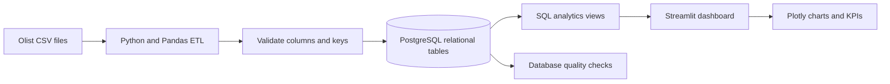
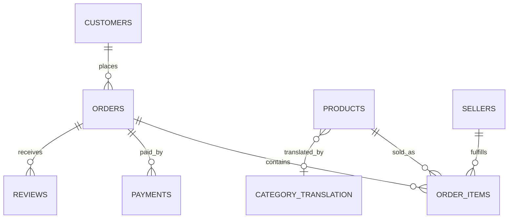

# Brazilian E-Commerce Analytics

An end-to-end analytics project built on Olist’s public Brazilian marketplace data. It turns nine source CSV files into a validated PostgreSQL model, creates SQL analytics views, and serves an interactive Streamlit dashboard.

## Project snapshot

- **Source data:** 9 CSVs, including 1,000,163 geolocation rows
- **Loaded:** 99,441 customers, 99,441 orders, 112,650 order items, 103,886 payments, 99,224 reviews, plus product, seller, category, and geolocation records
- **Analytics:** 24 monthly periods and 98,199 eligible orders in the loaded dataset
- **Quality:** 9 database checks passed; 5 automated tests passed

Counts describe the dataset version used for this local run. The original [Brazilian E-Commerce Public Dataset by Olist](https://www.kaggle.com/datasets/olistbr/brazilian-ecommerce) is distributed separately; this repository contains project code, not the CSVs.

## Business questions

- How do order volume and merchandise sales change by month?
- Which product categories and customer states contribute the most merchandise value?
- How long do orders take to arrive, and what share arrive later than estimated?
- How does delivery performance vary with customer review scores?

## Architecture



The ETL validates the full input set before loading, parses dates and numeric values, and loads tables in foreign-key order. The database refresh runs in a transaction: if any load or check fails, PostgreSQL rolls back the refresh. Inserts are chunked for a modest local machine. The source CSVs are read-only inputs and are never modified.

## Data model



The `public` schema stores customers, sellers, products, category translations, orders, order items, payments, reviews, and geolocation. Foreign keys connect orders to customers and items/payments/reviews to their parent records. Olist reuses `review_id` across different orders, so reviews use the composite primary key `(review_id, order_id)`. Geolocation retains multiple rows per postal prefix and is indexed for lookup rather than forced into a one-row-per-prefix key.

`sql/analytics.sql` creates:

- `analytics.order_line_facts`: one row per order item with customer, product, category, seller, delivery, payment, and review context.
- `analytics.monthly_sales`: monthly order, customer, merchandise, freight, and order-value aggregates.

## Dashboard metrics

All panels use the selected order-month range.

- **GMV:** item price, excluding freight; canceled and unavailable orders are excluded.
- **Average order value:** item price plus freight divided by eligible orders across the full selected range (a weighted value).
- **Unique buyers:** distinct customer IDs across the full selected range, not a sum of monthly counts.
- **Late delivery:** delivered after the estimated date, among delivered orders with an estimate.
- **Review score:** mean review score per order, compared with delivery outcomes.

## Run locally (macOS / Anaconda)

1. Install and start PostgreSQL (Postgres.app works well on Apple silicon). Create a database named `olist`.
2. From this project directory, create and activate the environment:

   ```bash
   conda env create -f environment.yml
   conda activate olist-analytics
   ```

3. Copy `.env.example` to `.env` once, then set the directory containing the nine CSVs and the PostgreSQL connection URL. For the default Postgres.app setup, use your macOS account name as the database user and leave the password blank. Example:

   ```text
   DATA_DIR=/path/to/olist-csv-folder
   DATABASE_URL=postgresql+psycopg://your_mac_username@localhost:5432/olist
   ```

4. Load or refresh the database:

   ```bash
   python -m olist_analytics.etl
   ```

5. Run the tests and launch the dashboard:

   ```bash
   pytest
   streamlit run app.py
   ```

The local `.env`, downloaded data, Python caches, and package build metadata are excluded from Git. The ETL replaces only the project’s target tables in the configured database.

## Repository layout

```text
app.py                       Streamlit dashboard
src/olist_analytics/         ETL, configuration, and quality checks
sql/schema.sql               Relational tables, constraints, and indexes
sql/analytics.sql            Dashboard-ready SQL views
tests/                       Automated tests
environment.yml              Reproducible Conda environment
```

## Skills demonstrated

Python and Pandas ingestion, PostgreSQL schema design, SQL modeling and aggregation, transactional ETL, data-quality validation, dashboarding, and automated tests.
